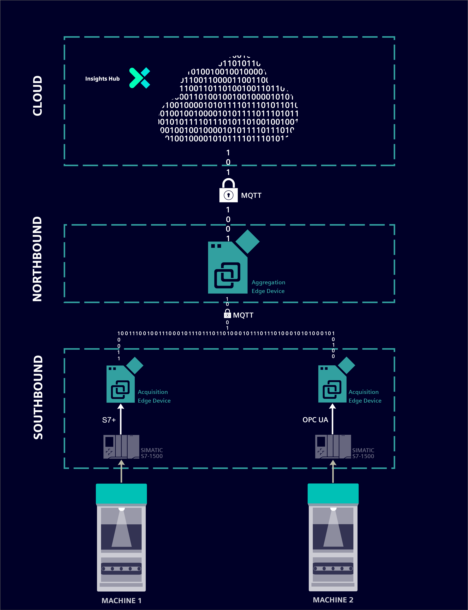
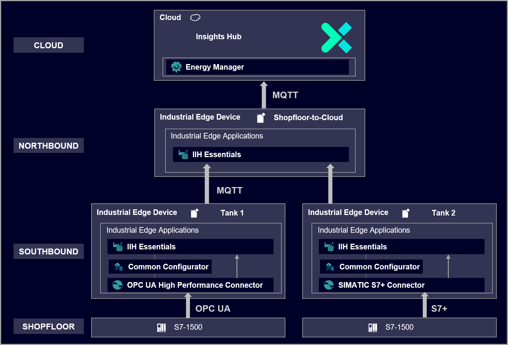
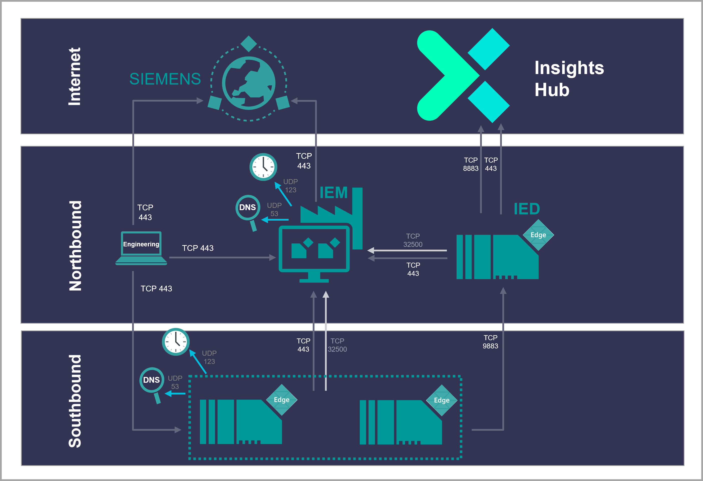

# Shopfloor to Cloud Connectivity - Integrate machine & production data securely into the company cloud

Use case for communication from Edge Device to Edge Device and company Cloud (e.g. Insights Hub, formerly known as MindSphere) via MQTT

- [Shopfloor to Cloud Connectivity - Integrate machine \& production data securely into the company cloud](#shopfloor-to-cloud-connectivity---integrate-machine--production-data-securely-into-the-company-cloud)
  - [Overview](#overview)
    - [Reference Architecture](#reference-architecture)
    - [Network Architecture](#network-architecture)
  - [General task](#general-task)
  - [Requirements](#requirements)
    - [Prerequisites](#prerequisites)
    - [Used components](#used-components)
  - [Configuration Southbound Devices](#configuration-southbound-devices)
  - [Configuration Northbound Device](#configuration-northbound-device)
  - [Configuration Insights Hub](#configuration-insights-hub)
  - [Documentation](#documentation)
  - [Contribution](#contribution)
  - [Licence and Legal Information](#licence-and-legal-information)

## Overview

The following image represents the data flow that will be achieved in this example, which covers everything from the acquisition of data from a machine in full production to its storage and processing in the cloud in general:

### Reference Architecture

This representation visualizes how data moves across edge applications within edge devices. The specific configurations of these applications will be detailed in this repository:

### Network Architecture

The following image illustrates the interaction and communication between all the devices used:

## General task

Gathering of tank data from two PLCs (Tank Application Example) and structuring it in asset models in the IIH Essentials of two southbound Edge Devices with no internet access.

Central monitoring of the tank data from multiple locations in dashboards, with a strict separation between Automation Cell Network (Southbound) and Datacenter (Northbound). Because there is no direct connection between Southbound and the connected PLCs to the Internet, this guideline minimizes security risks.

Synchronizing the data via IIH synchronization with a northbound Edge Device with internet connectivity.

Forwarding the synchronized Tank assets from the northbound Edge Device to Insights Hub.

## Requirements

### Prerequisites

- Industrial Edge Learning Path (Module 1-3)
- Established connection to 2 PLCs to acquire data with the Edge Devices
- Access to an Industrial Edge Management System (IEM)
- Onboarded 3 Industrial Edge Devices (IEDs) on Industrial Edge Management
- Installed System App Configurators on IEM (Common Configurator, Databus Configurator)
- Installed apps on Southbound-Devices (Common Configurator, IIH Essentials, Databus, OPCUA HighPerformance Connector on Tank-1, SIMATIC S7+ Connector on Tank-2)
- Installed apps on Northbound-Device (Common Configurator, IIH Essentials, Databus)
- Google Chrome or Firefox
- Access to Insights Hub
- Energy Manager
  
### Used components

TIA & PLCs:

- TIA V19
- PLCSIM Advanced (2 instances with the [Siemens Tank Application](https://github.com/industrial-edge/miscellaneous/tree/main/tank%20application))

Industrial Edge:

- Industrial Edge Management Pro V2 V2.3.2
- Industrial Edge Virtual Device V1.28.1
- OPCUA HighPerformance Connector V1.2.1
- SIMATIC S7+ Connector V2.4.1
- Databus V4.0.0
- IIH Essentials V2.6.0
- Common Configurator V2.6.0
- Web browser (Mozilla or Chrome)
- Common Configurator (IEM) V1.1.0
- Databus Configurator V4.0.0

Insights Hub:

- Asset Manager
- Energy Manager

## Configuration Southbound Devices

You can find further information about the following steps in the [docs](docs/install_PLC_Devices_Southbound.md)

- Configuration Steps
- Configure PLC project in TIA-Portal
- Configure PLC connections in Industrial Edge
  - Create Databus Credentials and Topics
  - Configure the Connectors in Common Configurator
    - Enter Databus Credentials
    - Add PLC for Tank-1
    - Add PLC for Tank-2
    - Add Tags
  - Manage Data
    - Verify local IIH values

## Configuration Northbound Device

You can find further information about the following steps in the [docs](docs/install_Device_Northbound.md)

- Configuration Steps
- Configure Northbound
  - Create Databus Credentials and Topics
  - Configure IIH Synchronization
    - Configure Send to the Northbound on the Child Devices
    - Configure Receive on the Parent Device
  - Insights Hub Sync
    - Prerequisites
    - Certificate Credentials
    - Configure Connection to Insights Hub
    - Select the Assets for Insights Hub

## Configuration Insights Hub

You can find further information about the following steps in the [docs](docs/install_MindSphere.md)

- Configuration Steps
- IIH Insights Hub Sync
- Configure Energy Manager
  - Overview Dashboard
    - Create widget for Produced Bottles of Each Tank
    - Create widget for Consumption Graphic of Each Tank
    - Create widget for Cost of each Tank

## Documentation

You can find further documentation and help in the following links

- [Industrial Edge Hub](https://iehub.eu1.edge.siemens.cloud/#/documentation)
- [Industrial Edge Forum](https://www.siemens.com/industrial-edge-forum)
- [Industrial Edge landing page](https://new.siemens.com/global/en/products/automation/topic-areas/industrial-edge/simatic-edge.html)
- [Industrial Edge Learning Path](https://siemens-learning-simaticedge.sabacloud.com/)
- [Energy Manager on Insights Hub application manual](https://documentation.mindsphere.io/resources/html/energy-manager/en-US/index.html)

## Contribution

Thank you for your interest in contributing. Anybody is free to report bugs, unclear documentation, and other problems regarding this repository in the Issues section.
Additionally everybody is free to propose any changes to this repository using Pull Requests.

If you haven't previously signed the [Siemens Contributor License Agreement](https://cla-assistant.io/industrial-edge/) (CLA), the system will automatically prompt you to do so when you submit your Pull Request. This can be conveniently done through the CLA Assistant's online platform. Once the CLA is signed, your Pull Request will automatically be cleared and made ready for merging if all other test stages succeed.

## Licence and Legal Information

Please read the [Legal information](LICENSE.md).
