# Configuration Steps

- [Configuration Steps](#configuration-steps)
- [Configure Northbound](#configure-northbound)
  - [Create Databus Credentials and Topics](#create-databus-credentials-and-topics)
  - [Configure IIH Synchronization](#configure-iih-synchronization)
    - [Configure Databus Credentials on the Parent Device](#configure-databus-credentials-on-the-parent-device)
    - [Configure Send to the Northbound on the Child Devices](#configure-send-to-the-northbound-on-the-child-devices)
    - [Configure Receive on the Parent Device](#configure-receive-on-the-parent-device)
  - [Insights Hub Sync](#insights-hub-sync)
    - [Prerequisites](#prerequisites)
    - [Certificate Credentials](#certificate-credentials)
    - [Configure Connection to Insights Hub](#configure-connection-to-insights-hub)
    - [Select the Assets for Insights Hub](#select-the-assets-for-insights-hub)
- [Navigation](#navigation)
  
# Configure Northbound

The Northbound consists of one device. In the following this is called "Shopfloor-to-Cloud". In this example it uses the IP address `10.14.7.21`; adapt it to your network.
Installed Apps:

- IIH Essentials
- Databus
- Common Configurator

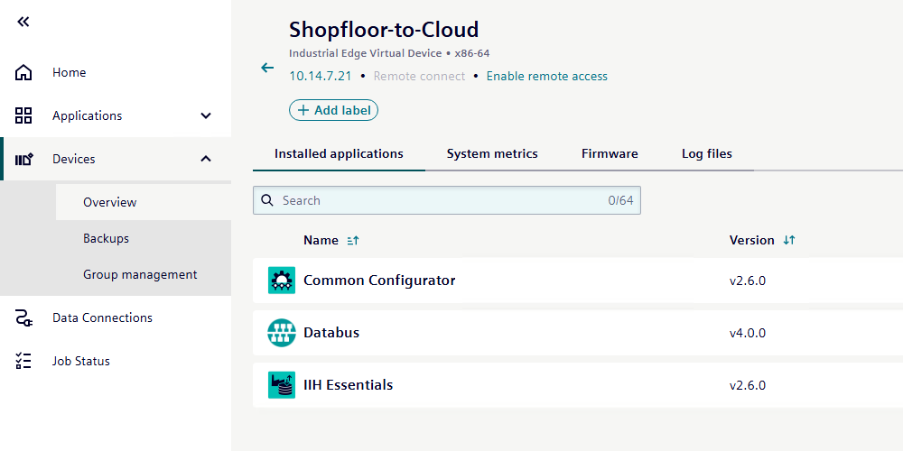

DataXess, IIH Semantics, Registry Service or a separate External Databus app are not required.

## Create Databus Credentials and Topics

Configure the User and Topic in the Databus Configurator as described in [Installation of PLC Devices Southbound](install_PLC_Devices_Southbound.md).  

1. In the Industrial Edge Management, launch the Databus Configurator on "Shopfloor-to-Cloud" and add your related Credentials/Topics:

   - Username: `edge`
   - Password: `edge`
   - Topics: `ie/#` and `/sync/#`
   - Permission: `Publish and Subscribe`

   > [!NOTE]
   > `edge` / `edge` are example credentials for this lab setup only. Use strong, unique passwords in real deployments.

   An additional topic `/sync/#` is required for the IIH synchronization between the Tank devices and Shopfloor-to-Cloud. Create this topic in the Databus Configurator as well by clicking the plus sign in the topic list.
  
   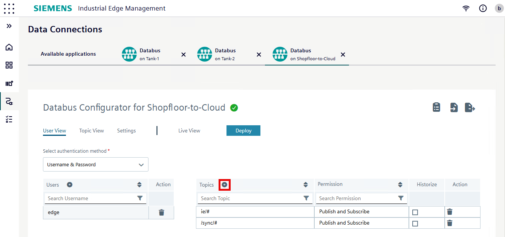

1. Go to *Settings* and enable *Connection to External Clients*, so that the Tank devices can connect to the Databus of Shopfloor-to-Cloud. In this example, *No encryption (unsecure)* is selected and the Databus is reached at `10.14.7.21:9883`.

   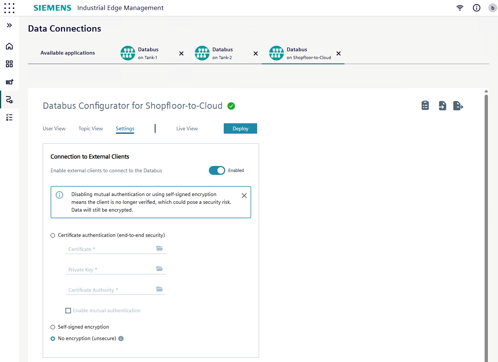

   > [!WARNING]
   > Unencrypted external Databus access is used only for this isolated lab example. Do not use these settings as production security guidance.

1. Deploy configuration to device

## Configure IIH Synchronization

In this section, we will configure the synchronization between the two acquisition devices (Tank-1 and Tank-2) and the aggregation device (Shopfloor-to-Cloud). The Tank devices send their data to the external Databus endpoint of Shopfloor-to-Cloud, where it is received by IIH Essentials.

### Configure Databus Credentials on the Parent Device

1. Configure the Databus credentials in the Common Configurator on "Shopfloor-to-Cloud" under "Settings > Databus credentials" in the same way as described in the [southbound guide](install_PLC_Devices_Southbound.md#enter-databus-credentials).

2. Save the configuration

### Configure Send to the Northbound on the Child Devices

On each Tank IED, open *Synchronize data > Send* in Common Configurator and add a destination with these settings:

| Setting | Example value |
| --- | --- |
| Destination type | Industrial Information Hub (IIH) |
| System name | `Tank-1` or `Tank-2`, unique for each child |
| Display name | `Northbound Device` |
| Parent system name | `Shopfloor-to-Cloud`, matching the parent IIH |
| OPC UA synchronization | Inactive |
| Data synchronization | Active, cycle 1 second |
| MQTT host / port | `10.14.7.21` / `9883` (parent Databus external endpoint) |
| Use credentials | Active; use a user configured on the parent Databus |
| Use SSL/TLS | Inactive in this isolated lab; match your broker configuration |
| State | Active |

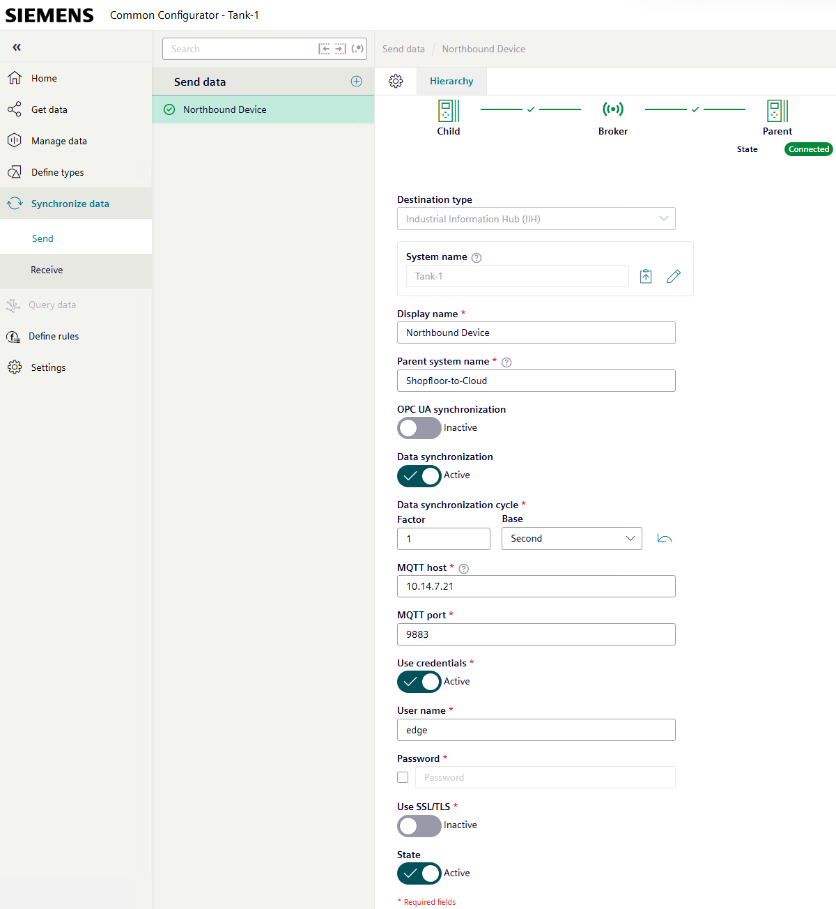

Select the Tank assets and variables to synchronize in the destination's *Hierarchy* tab and save the configuration. Repeat for the other child with its own system name and hierarchy.

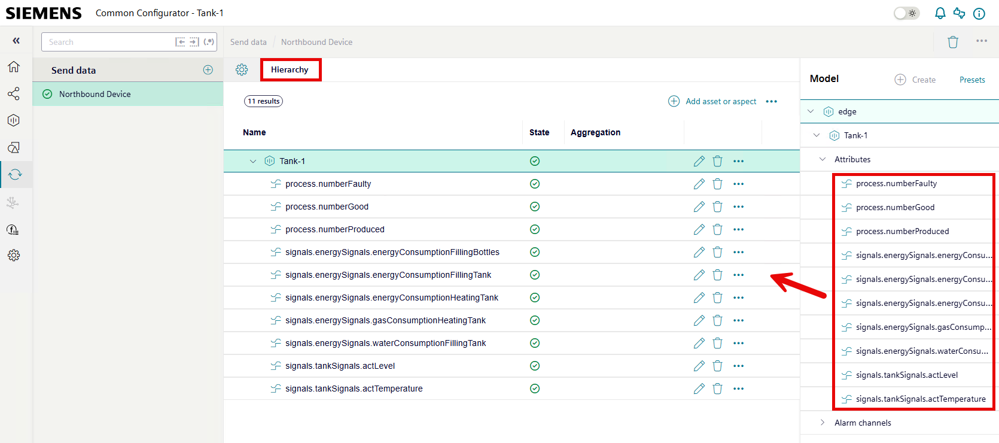

### Configure Receive on the Parent Device

1. Go to *Edge Device UI > Apps* on "Shopfloor-to-Cloud" and open *Common Configurator*. Then, go to *Synchronize data > Receive*.

2. Add a new receive configuration with the following settings and save the changes:

   | Setting | Example value |
   | --- | --- |
   | System name | `Shopfloor-to-Cloud`, matching the parent system name configured on the Tank devices |
   | Name | `IIH Sync` |
   | MQTT host / port | `10.14.7.21` / `9883` (external Databus endpoint of Shopfloor-to-Cloud) |
   | Use credentials | Active; user `edge` and its password |
   | Use SSL/TLS | Inactive in this isolated lab; match your Databus configuration |
   | State | Active |

   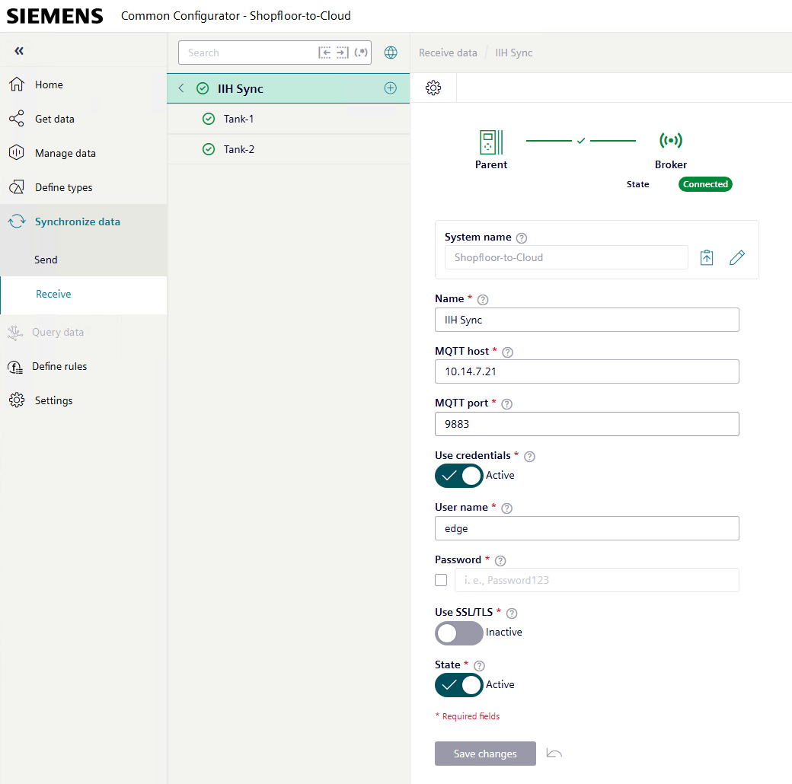

If everything was configured correctly, the broker state is "Connected" and Tank-1 and Tank-2 are listed with a green status under the receive configuration, as shown above. The Tank assets and their changing values are now available in IIH Essentials on Shopfloor-to-Cloud.

## Insights Hub Sync

In this section, the necessary configurations will be made to establish communication with the cloud (Insights Hub).

All the following steps for this option will be performed in the "Common Configurator" app on the Northbound Device (Shopfloor-to-Cloud).

### Prerequisites

A Technical User is needed in Insights Hub, see: [Insights Hub Documentation - Technical Users](https://documentation.mindsphere.io/MindSphere/apps/settings/technical-users.html)

The Technical User needs at least the following permissions:

- mdsp:core:assetmanagement.admin
- mdsp:core:assetmodeler.fullaccess
- mdsp:core:mindconnect.fullaccess

### Certificate Credentials

To create a new certificate, go to *Insights Hub UI > System Tools > Asset Manager*:

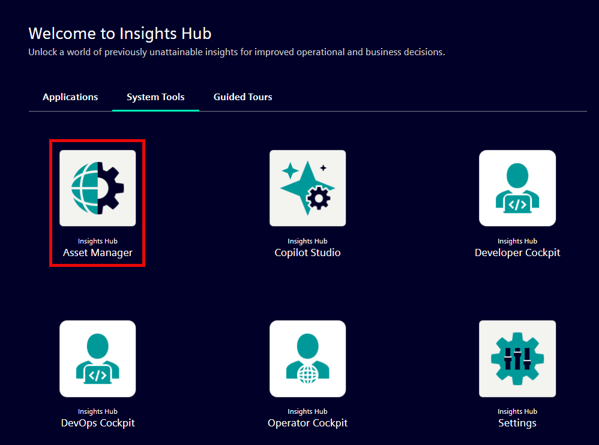

Then, go to *Asset Manager > Connectivity > MQTT Certificates*:

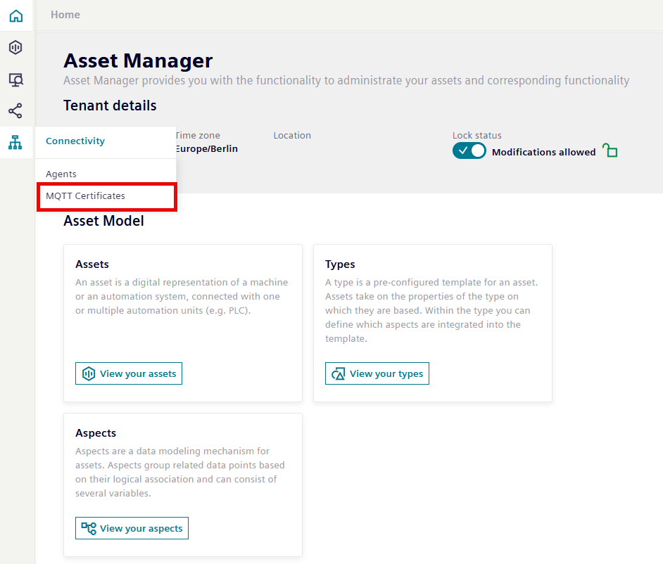

Click on "Create a new certificate":

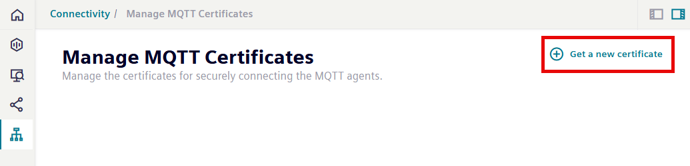

Now, select the type of authentication:

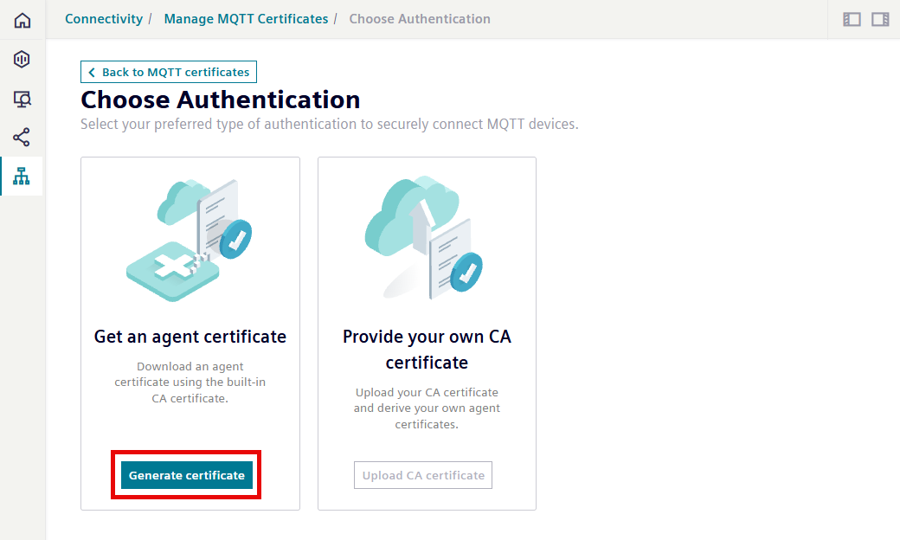

Create the certificate name and enter the author email:

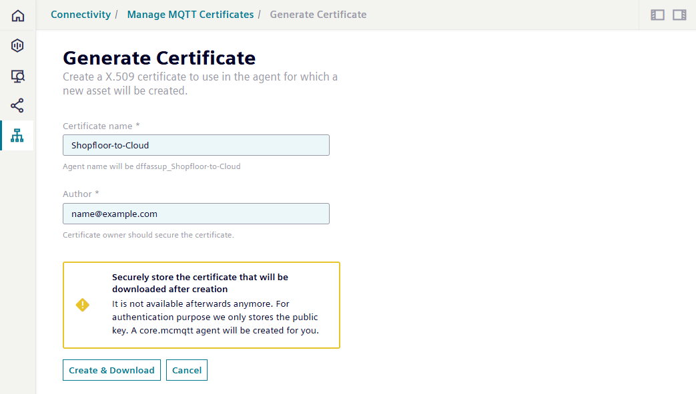

As soon as you click on the "Create & Download" button, the following files will be automatically downloaded:

- Certificate file (.pem)
- Certificate key file (.key)

### Configure Connection to Insights Hub

Add a new data destination for Insights Hub in the Common Configurator app on the Northbound IED.

1. Go to *Synchronize data > Send* and click the plus icon to add a new data destination.

2. The following settings are required to allow the data synchronization to interact with Insights Hub:

    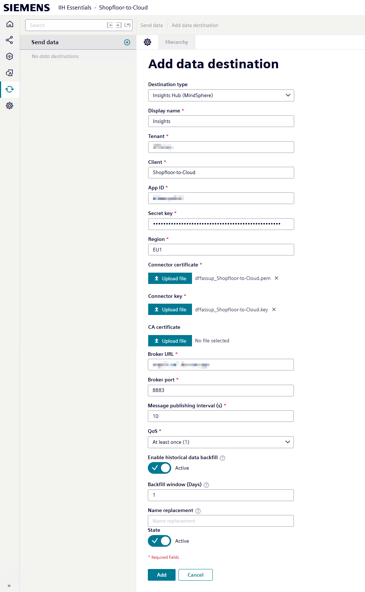

    - Destination type: Insights Hub (MindSphere)
    - Display name: Insights Hub
    - Tenant: *enter your Insights Hub Tenant* you can find this in your Insights Hub URL "https://[tenant].[region].mindsphere.io/home"
    - Client: *enter the certificate name from the previous step, for this case, it was named "Shopfloor-to-Cloud"*
    - App ID: *enter the technical user you created*
    - Secret key: *enter the technical user generated secret key*
    - Region: *enter your region* you can find this in your Insights Hub URL "https://[tenant].[region].mindsphere.io/home"
    - Connector certificate: *upload the .pem file*
    - Connector key: *upload the .key file*
    - Broker URL: *the Broker URL for your tenant/region*, usually something like "mqtt.ih.[region].siemens.app"
    - Broker port: *enter the Broker port for your tenant, typically 8883*

    The other values can stay as default unless specific requirements dictate otherwise.

   > [!IMPORTANT]
   > More information can be found in the [IIH Documentation](https://docs.industrial-operations-x.siemens.cloud/r/en-us/v2.6/industrial-information-hub/) and the [Insights Hub Operator Cockpit Documentation](https://documentation.mindsphere.io/MindSphere/apps/operator-cockpit/application-credentials-for-API-applications.html).
   > Information on how to create connector certificates can be found in the [MindConnect MQTT Agent Onboarding HowTo](https://documentation.mindsphere.io/MindSphere/howto/howto-onboard-mindconnect-mqtt.html), [MindSphere Managing CA Certificates HowTo](https://documentation.mindsphere.io/MindSphere/howto/howto-managing-ca-certificates.html) and [MindConnect Agent Certificate HowTo](https://documentation.mindsphere.io/MindSphere/howto/howto-obtaining-auto-generated-agent-certificate.html).

3. Click "Add". The connection will be established and you should see a green status for the Insights Hub destination in the IIH Essentials overview:

   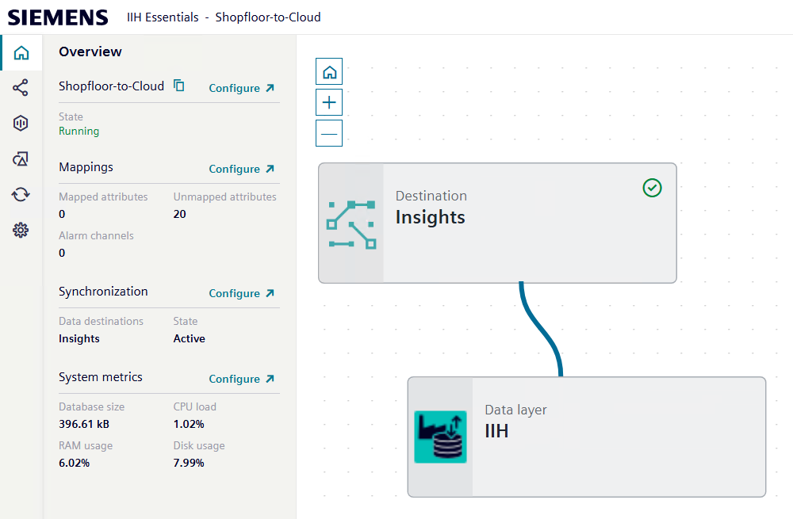

### Select the Assets for Insights Hub

The Tank-1 and Tank-2 assets are received through the IIH synchronization, so no additional Asset Model has to be created on the Shopfloor-to-Cloud device.

1. Open the created data destination under *Synchronize data > Send* and go to the *Hierarchy* tab.

2. Add the received assets `Tank-1` and `Tank-2` from the *Model* on the right to the hierarchy and save the configuration:

    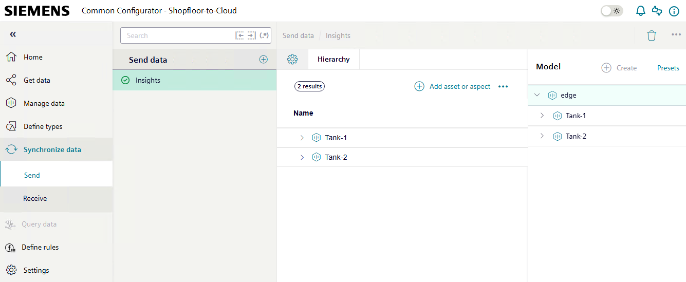

    In Insights Hub, you should now see the Tank-1 and Tank-2 assets with their changing values.

Up to this point, the following steps have been completed:

- Communication has been established between the Southbound devices (Tank-1 and Tank-2) and the Northbound device (Shopfloor-to-Cloud).

- Communication has been established between the Northbound device (Shopfloor-to-Cloud) and the cloud (Insights Hub).

How to check the received data is described in the [Insights Hub guide](install_MindSphere.md).

# Navigation

[Overview](../README.md)

[Configuration Southbound Device](install_PLC_Devices_Southbound.md)

[Configuration Insights Hub](install_MindSphere.md)
