# Configuration Steps

- [Configuration Steps](#configuration-steps)
- [IIH Insights Hub Sync](#iih-insights-hub-sync)
- [Configure Energy Manager](#configure-energy-manager)
  - [Overview Dashboard](#overview-dashboard)
    - [Create widget for Produced Bottles of Each Tank](#create-widget-for-produced-bottles-of-each-tank)
    - [Create widget for Consumption Graphic of Each Tank](#create-widget-for-consumption-graphic-of-each-tank)
    - [Create widget for Cost of each Tank](#create-widget-for-cost-of-each-tank)
- [Navigation](#navigation)
  
# IIH Insights Hub Sync

To analyze incoming data from the Shopfloor-to-Cloud edge device in Insights Hub, you can use the Energy Manager application to create dashboards so you can process and display the supplied data.

For this, a dashboard **Overview** is created using the data collected from the Shopfloor:

- Produced Bottles of Each Tank
- Consumption Graphic of Each Tank
- Cost of each Tank

The configuration file for the dashboard is presented below:

- [Overview_Dashboard.json](../src/Overview_Dashboard.json)

To import the dashboard, go to *Energy Manager UI*, select the asset, click on "Add dashboard", select "Import Dashboard" and upload the corresponding dashboard configuration file.

The step-by-step instructions for building the dashboard are shown below.

# Configure Energy Manager

From here, the step-by-step process of creating each dashboard will be explained.

## Overview Dashboard

This is the final result of the dashboard:

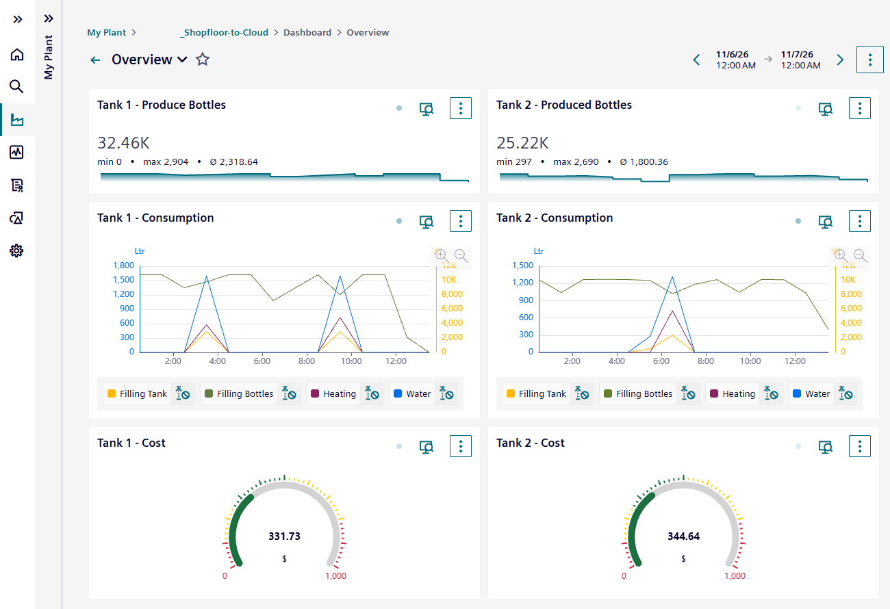

Now, create a new dashboard by going to *My Plant*, select the "Shopfloor-to-Cloud" asset, click on "Add dashboard" and name it "Overview":

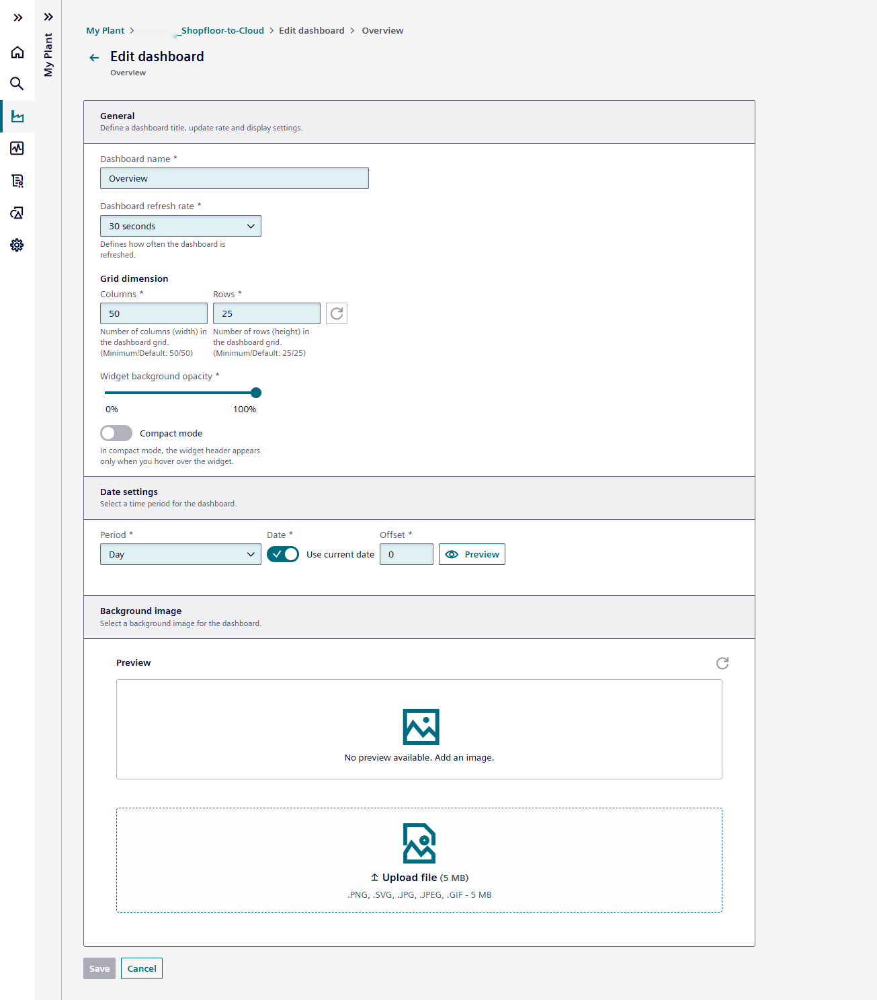

### Create widget for Produced Bottles of Each Tank

To create a widget for the Produced Bottles of Each Tank, follow these steps:

Click "Add widget" from the dashboard menu.

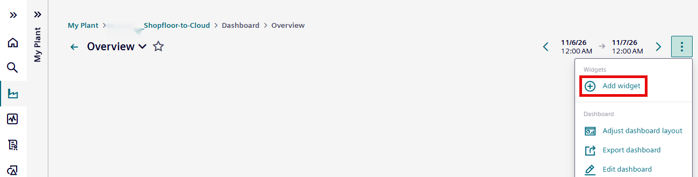

Create a "Value" widget to display the Produced Bottles of Tank 1, name it "Tank 1 - Produced Bottles" and attach it to the "process_numberProduced" parameter on the Tank-1 asset, like so:

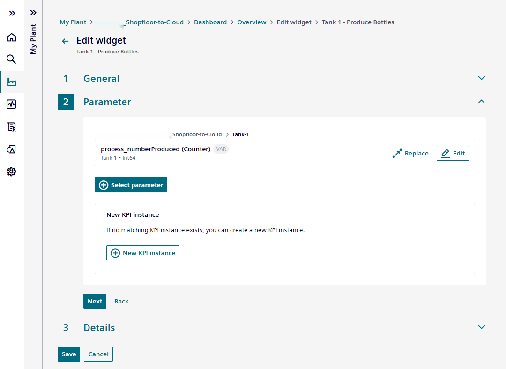

Then, just click save, place the widget in the dashboard layout and repeat the same process for Tank 2.

### Create widget for Consumption Graphic of Each Tank

Create a "Diagram" widget, name it "Tank 1 - Consumption" and attach it to the following parameters:

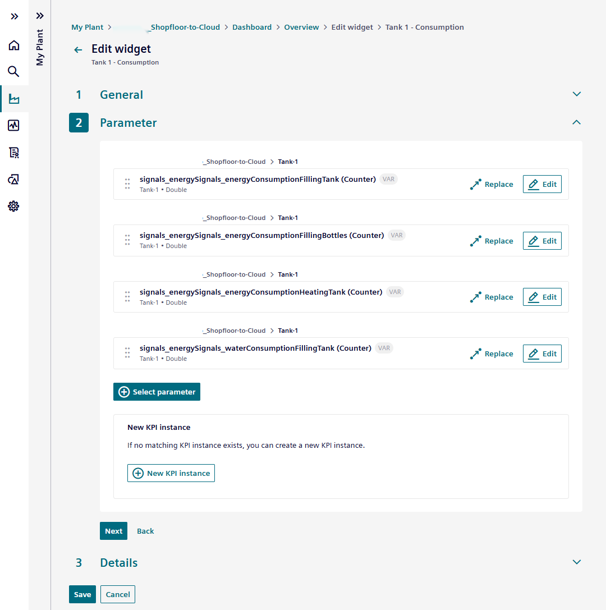

Make sure to have this Y-Axis configuration:

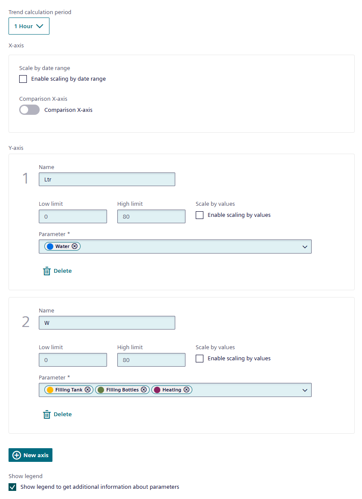

Then, just click save, place the widget in the dashboard layout and repeat the same process for Tank 2.

### Create widget for Cost of each Tank

For this widget, a new KPI type needs to be created. Go to *Energy Manager UI > Configuration > KPI Types* and create a new KPI type with the information provided:

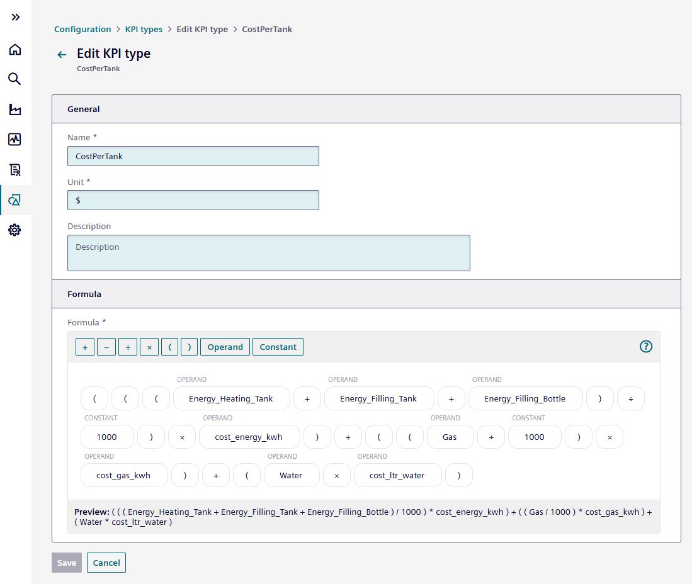

Then, create a KPI instance named "Tank 1 - Cost" based on the previously created KPI type. For this, go to the "Shopfloor-to-Cloud" asset and go to the Parameters section:

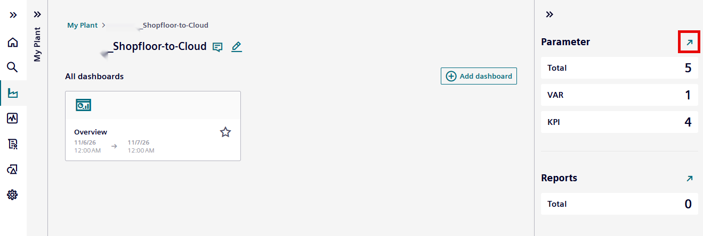

There, click on "Add KPI instance":

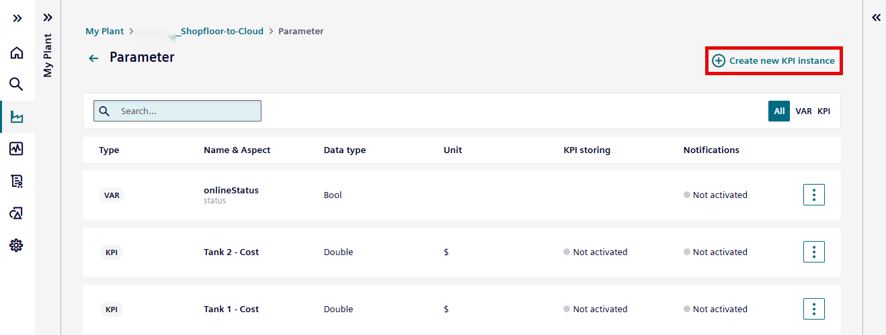

Fill in the required information to create the KPI instance for Tank 1.

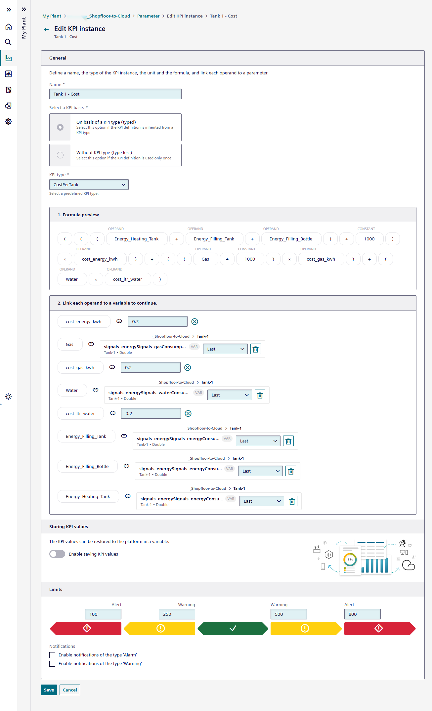

Now, create a "Gauge" widget, name it "Tank 1 - Cost" and attach it to the KPI instance you just created:

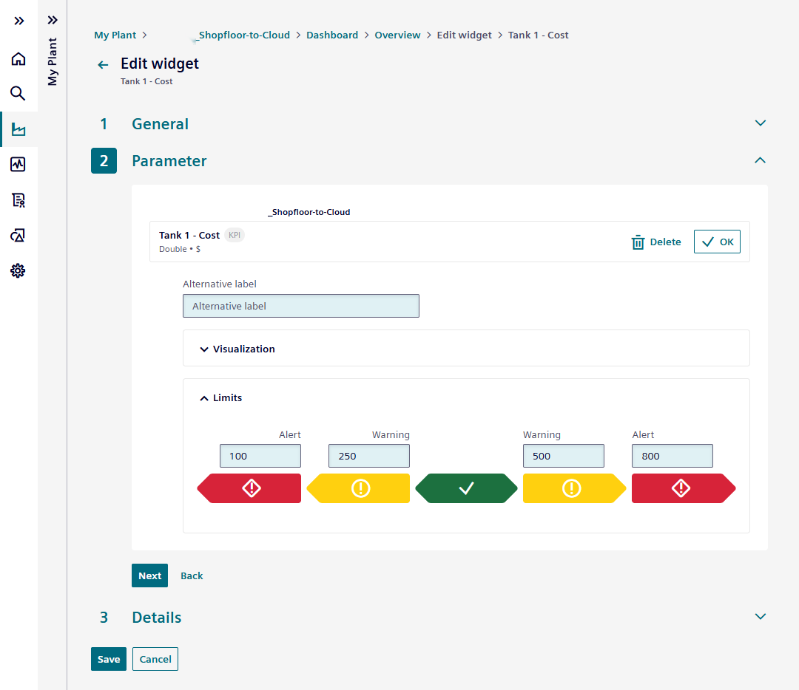

Then, just click save, place the widget in the dashboard layout and repeat the same process for Tank 2.

You just created the "Overview" Dashboard!

# Navigation

[Overview](../README.md)

[Configuration Southbound Device](install_PLC_Devices_Southbound.md)

[Configuration Northbound Device](install_Device_Northbound.md)
