# Configuration Steps

- [Configuration Steps](#configuration-steps)
- [Configure PLC-Project in TIA-Portal](#configure-plc-project-in-tia-portal)
- [Configure PLC connections in Industrial Edge](#configure-plc-connections-in-industrial-edge)
  - [Create Databus Credentials and Topics](#create-databus-credentials-and-topics)
  - [Configure the Connectors in Common Configurator](#configure-the-connectors-in-common-configurator)
    - [Enter Databus Credentials](#enter-databus-credentials)
    - [Add PLC for Tank-1](#add-plc-for-tank-1)
    - [Add PLC for Tank-2](#add-plc-for-tank-2)
    - [Add tags](#add-tags)
  - [Manage Data](#manage-data)
    - [Verify local IIH values](#verify-local-iih-values)
- [Navigation](#navigation)

# Configure PLC-Project in TIA-Portal

In this example we will use the same PLC Project for both PLCs, but with different PLCSIM Advanced instances and IP addresses to simulate two separate tanks.

Instead of using PLCSIM Advanced you can also use physical PLCs with the same project.

1. Download `tia-tank-application.zap19` from the [Siemens Tank Application example](https://github.com/industrial-edge/miscellaneous/tree/main/tank%20application). The V4.0 project requires TIA Portal V19 or later; the reference example uses PLCSIM Advanced V6.0 for simulation.

1. Retrieve the project in TIA Portal and prepare two PLCSIM Advanced instances, `Tank_1` and `Tank_2`. Adapt the PLC IP addresses to your network and ensure that each acquisition IED can reach its PLC. This example uses `10.14.7.111` for `Tank_1` and `10.14.7.112` for `Tank_2`.
  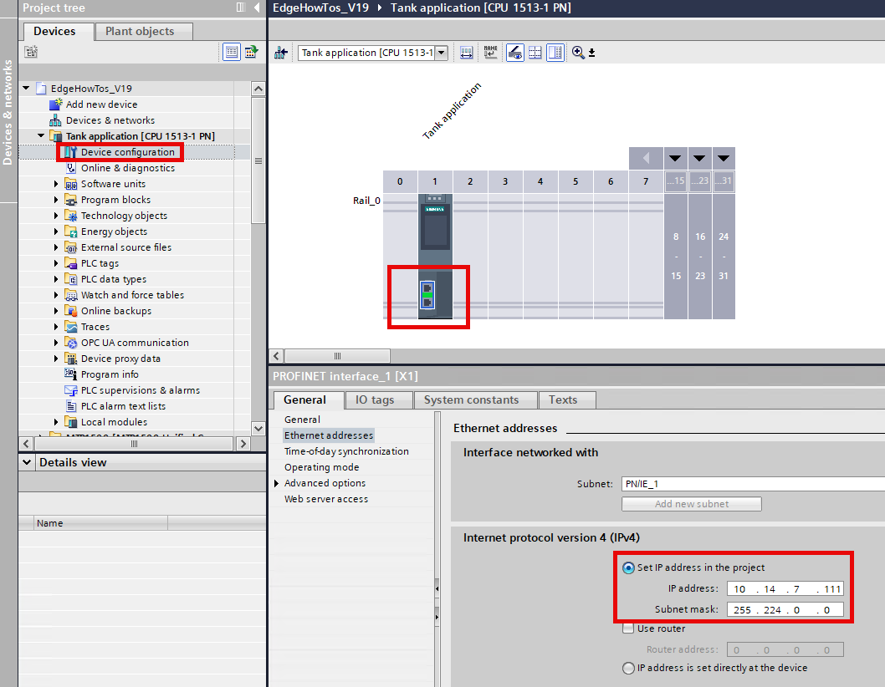

1. Download the Tank program to both PLC simulations and set them to RUN. Follow the Tank Application's operating instructions to start the simulation so that process values change. For `Tank_1`, ensure that the PLC OPC UA server is enabled and its tags are accessible.

# Configure PLC connections in Industrial Edge

The southbound consists of two edge devices, "Tank-1" and "Tank-2".
All addresses below are lab examples; adapt them to your network.

| IED Name | IED IP | PLC instance / IP | Used Connector |
| --- | --- | --- | --- |
| Tank-1 | `10.14.7.22` | Tank_1 / `10.14.7.111` | OPCUA HighPerformance Connector |
| Tank-2 | `10.14.7.23` | Tank_2 / `10.14.7.112` | SIMATIC S7+ Connector |

Installed apps on the IEDs:

- Common Configurator
- IIH Essentials
- Databus
- OPCUA HighPerformance Connector (on Tank-1)
- SIMATIC S7+ Connector (on Tank-2)

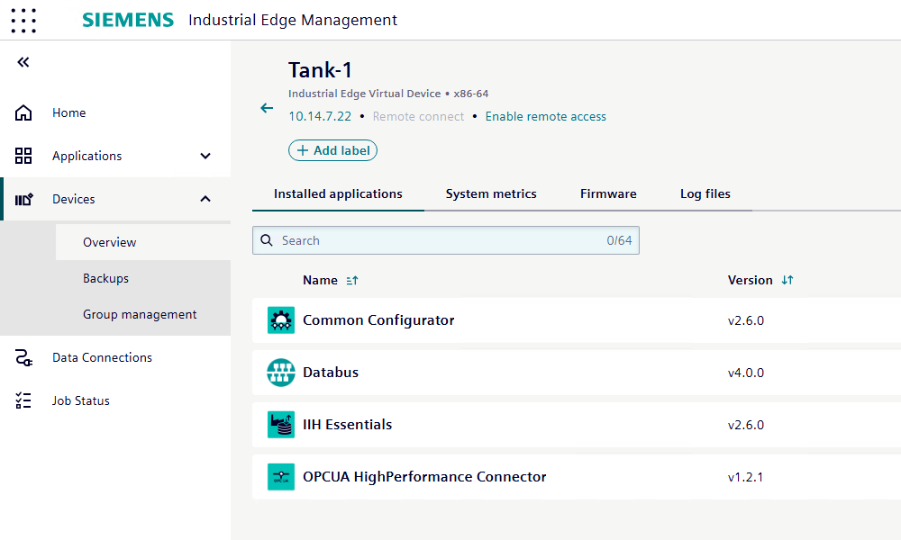

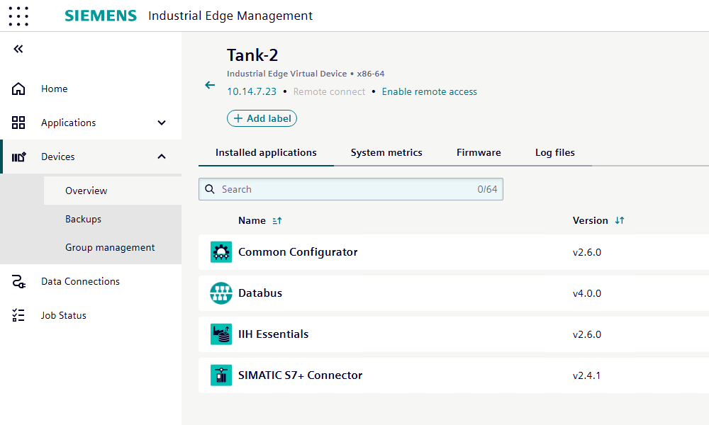

Each of the following steps is done in the Industrial Edge system and, as explained in the Reference Architecture shown in the main page, the OPCUA HighPerformance Connector and the SIMATIC S7+ Connector are used on the Industrial Edge Devices (IEDs) to read data from the PLCs and provide the data to the local IIH Essentials.

## Create Databus Credentials and Topics

Go to *Industrial Edge Management UI > Data Connections*, select *Databus* and launch its configurator on "Tank-1".

In *User View*, select username/password authentication and use the plus icon to create a user.

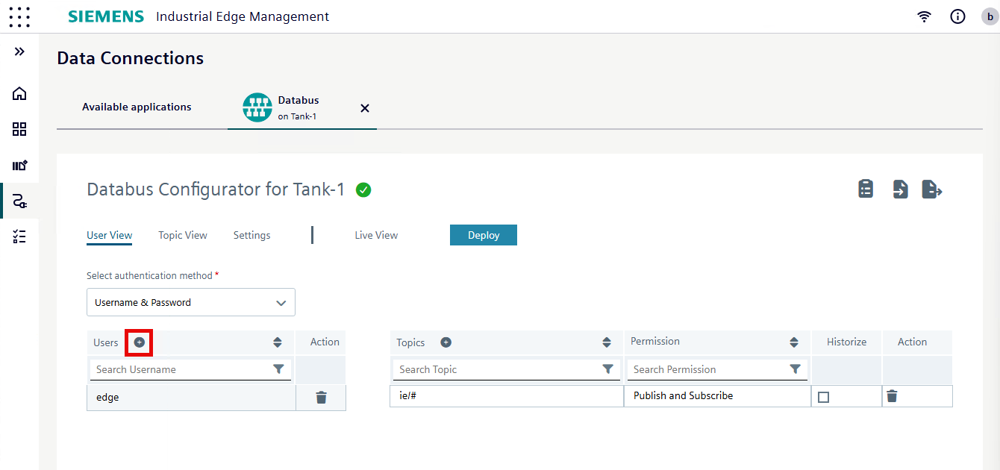

Here we use the following settings:

| Setting | Value |
| --- | --- |
| Topic name | `ie/#` |
| Username | `edge` |
| Password | `edge` |
| Permission | Publish and Subscribe |

> [!NOTE]
> `edge` / `edge` are example credentials for this lab setup only. Use strong, unique passwords in real deployments.

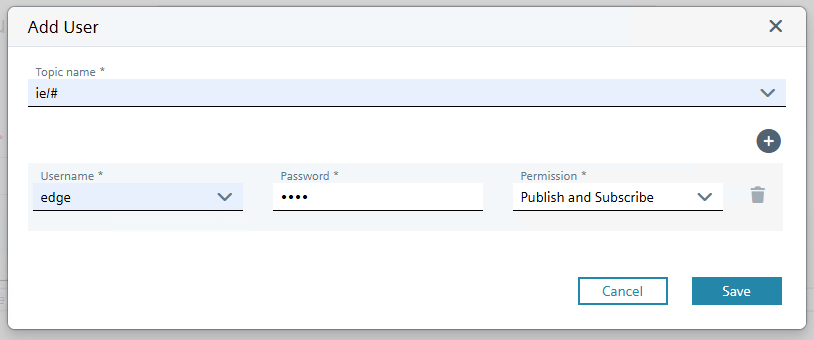

Click save, then deploy and repeat the same steps for the "Tank-2" edge device.

## Configure the Connectors in Common Configurator

In this section, the following steps will be addressed:

- Connect the "Tank-1" PLC to the "Tank-1" Edge device to retrieve tags via the OPC UA Connector.
- Connect the "Tank-2" PLC to the "Tank-2" Edge device to retrieve tags via the SIMATIC S7+ Connector.
  
To provide data from the PLC to the IIH, set up the connection and add the required PLC variables in the Connector. We will use Common Configurator to achieve this.

Go to each *Edge Device UI > Apps* and open *Common Configurator*.

### Enter Databus Credentials

On each acquisition IED, go to *Settings > Databus credentials* and enter the previously created Databus credentials. Use `ie-databus:1883` as the service name for the local publisher and subscriber, and save the settings.

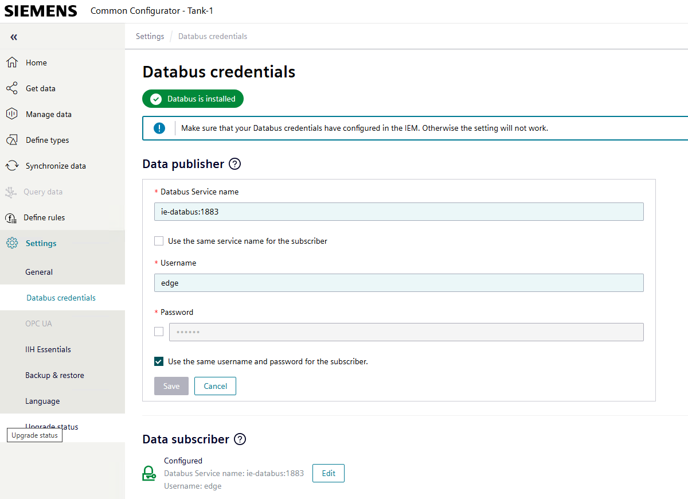

> [!IMPORTANT]  
> If the credentials were typed correctly you should see the "Valid Credentials" pop-up label on the top right as shown in the picture.

### Add PLC for Tank-1

On "Tank-1", go to *Get data > Connector configuration*, select *OPCUA HighPerformance Connector* and add a new data source with the following settings:

- Name: `Tank-1`
- OPC-UA Server URL: `opc.tcp://10.14.7.111`
- IP port number: `4840`
- Message Security Mode and Security policy: `None`
- Authentication mode: `Anonymous`
- Use Source TimeStamp: enabled

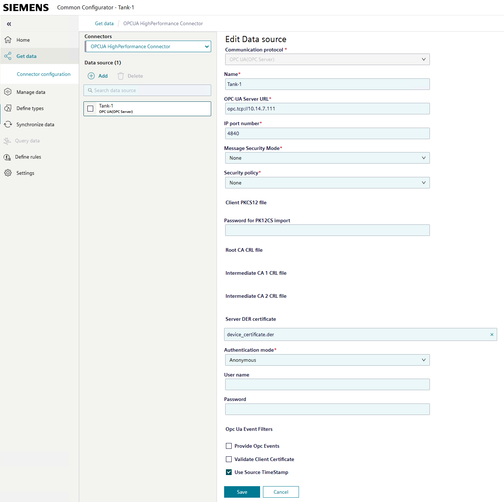

> [!WARNING]
> Anonymous, unencrypted OPC UA access is used only for this isolated lab example. Do not use these settings as production security guidance.

Alternatively, you can restore the connector configuration using the [Tank-1 connector configuration export](../src/Tank-1_opcuahpc1_export.json) to restore the supplied connection (including tags) through Common Configurator's *Settings > Backup & restore*. Review the imported data source and adapt its address before deploying.

### Add PLC for Tank-2

On "Tank-2", follow the same procedure with the *SIMATIC S7+ Connector*. Restore the [Tank-2 connector configuration export](../src/Tank-2_css7pdriver1_export.json) through *Settings > Backup & restore*, or add the data source and browse its tags manually. Review these settings before deploying:

- Communication protocol: `S7-1500 / S7-1200`
- Name: `Tank-2`
- IPv4 address: `10.14.7.112`
- Legitimation mode: *Legitimate via protection level password*
- Acquisition mode: *Provide data on change*
- Use source time stamp: enabled

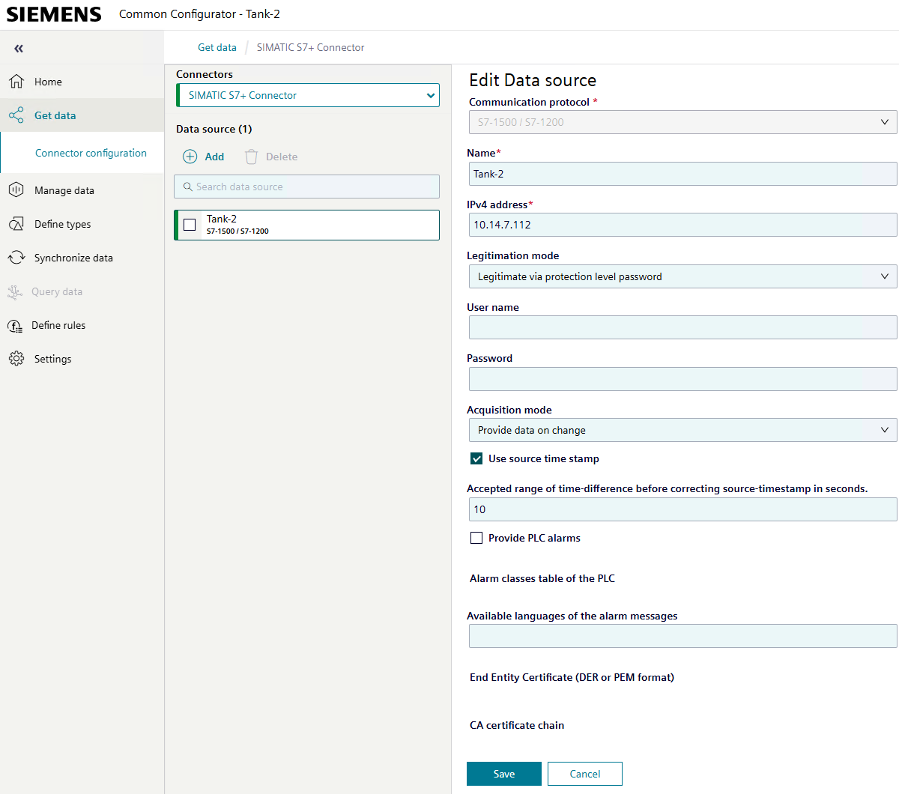

Alternatively, you can restore the connector configuration using the [Tank-2 connector configuration export](../src/Tank-2_css7pdriver1_export.json) to restore the supplied connection.

### Add tags

After saving the connection, use *Browse tags* to select the following tags:

- `GDB.signals.tankSignals.actLevel`
- `GDB.signals.tankSignals.actTemperature`
- `GDB.signals.energySignals.energyConsumptionFillingTank`
- `GDB.signals.energySignals.waterConsumptionFillingTank`
- `GDB.signals.energySignals.energyConsumptionHeatingTank`
- `GDB.signals.energySignals.energyConsumptionFillingBottles`
- `GDB.signals.energySignals.gasConsumptionHeatingTank`
- `GDB.process.numberProduced`
- `GDB.process.numberFaulty`
- `GDB.process.numberGood`

Use the filter to find the tags listed above. Select the tags, enter the acquisition cycle and access mode. Last, click *Import*. Deploy the connector configuration, then check that the connector and data source are connected.

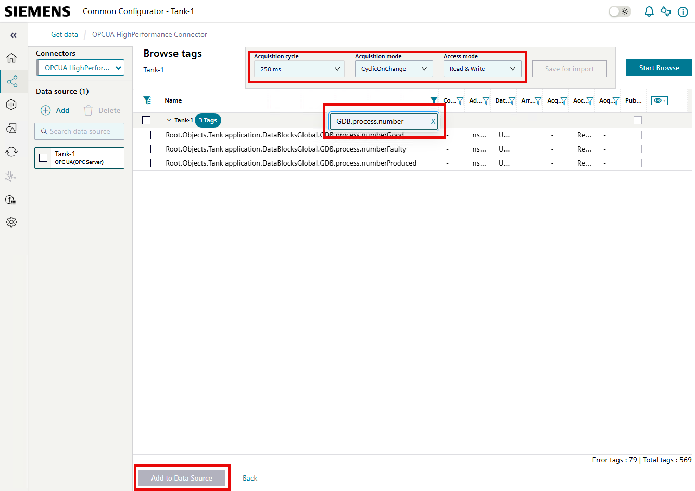

## Manage Data

The Tank values are used directly in IIH Essentials. For this, go to *Manage data* in Common Configurator and create a new asset for the Tank.

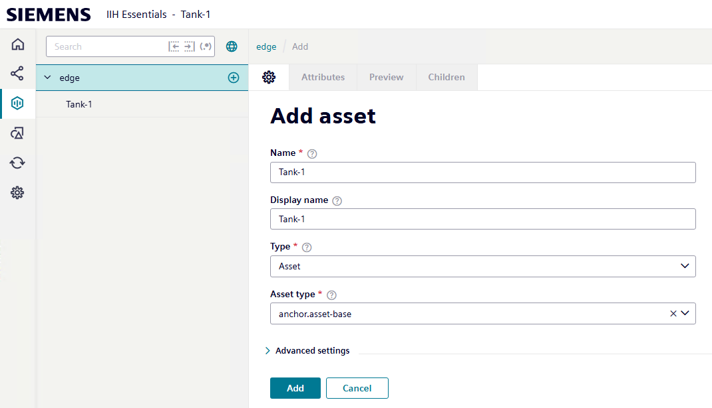

To add the tags from the connector, select the asset and open the *Attributes* tab. On the right side select the connector and choose the tags you want to add to the asset. Drag and drop the selected tags into the asset's attribute list.

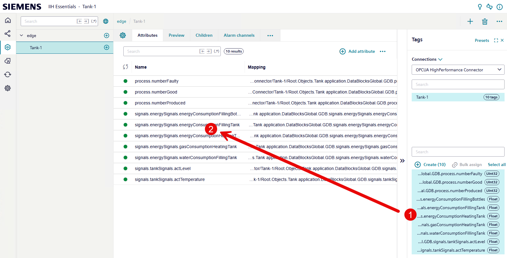

Apply the same changes for Tank-2.

### Verify local IIH values

The configuration will directly be referenced in IIH Essentials. Check the current values in the IIH while the Tank simulation is running. Compare the tank level, temperature, and produced-bottle counter with the corresponding PLC values. Confirm changing values on both IEDs before configuring synchronization.

If values do not update locally, check PLC RUN state, network reachability, connector status, and tag selection before proceeding.

# Navigation

[Overview](../README.md)

[Configuration Northbound Device](install_Device_Northbound.md)

[Configuration Insights Hub](install_MindSphere.md)
